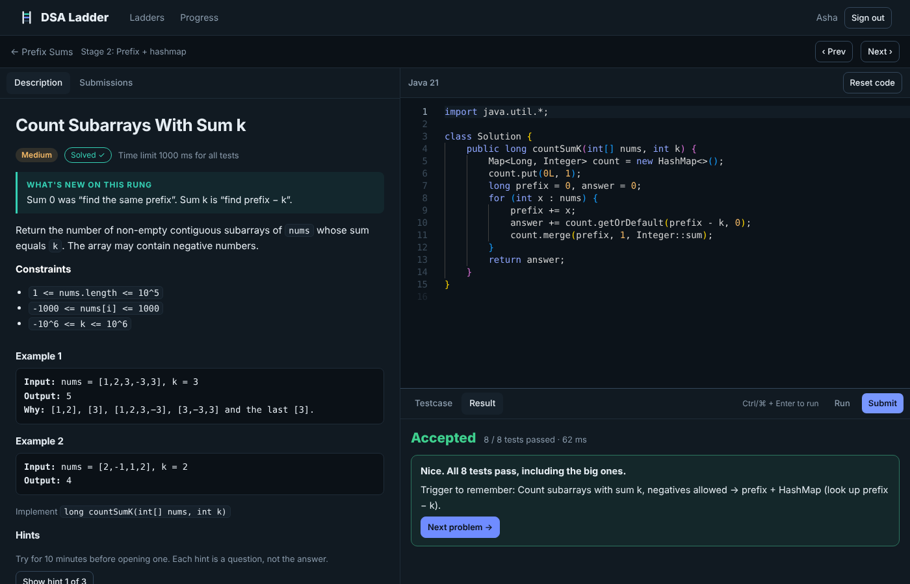
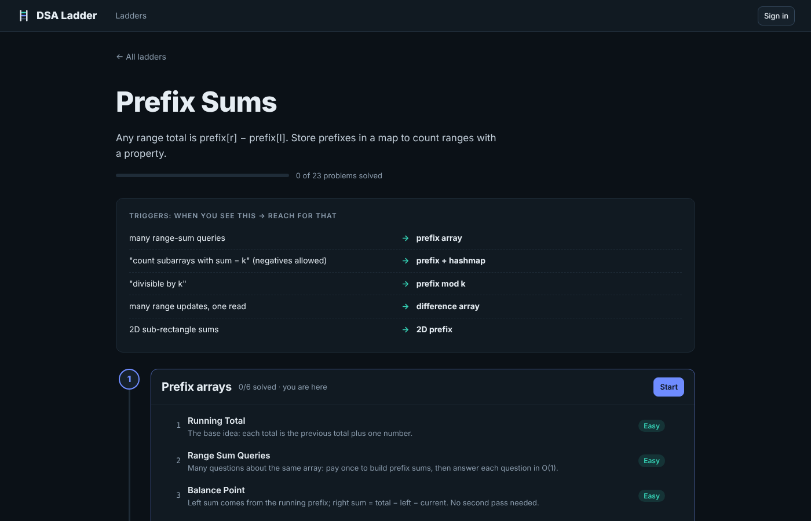
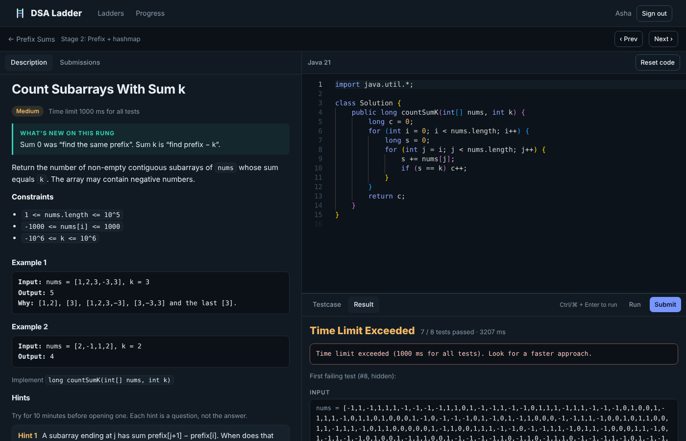

# DSA Ladder · Web

Frontend for **DSA Ladder**, a coding practice platform that builds problem-solving intuition the way maths books do:
lots of small problems on one idea, each a little harder than the last, then the real LeetCode problem as the final exam.

The API, judge and problem books live in **dsa-ladder-api**.



## Features

- **Ladders**: every topic is a ladder of stages; each problem shows what's new on its rung, and each stage ends with its LeetCode final exam.
- **Problem workspace**: statement, examples and question-style hints on the left; a Monaco Java editor on the right (bundled locally, no CDN).
- **Run and Submit**: LeetCode-style verdicts with the failing input, expected vs your output, runtime and captured `System.out`.
- **Custom test cases**: edit inputs per parameter; expected answers come from the server's reference solution.
- **Accounts**: sign up, submission history per problem, progress per ladder. Your code is autosaved in the browser.
- Keyboard: `Ctrl/⌘ + Enter` runs, `Ctrl/⌘ + Shift + Enter` submits.

| Ladder | Time Limit Exceeded on a brute-force solution |
|---|---|
|  |  |

## Tech

React 18 · TypeScript · Vite · React Router · Monaco editor · Marked · GitHub Actions

## Run locally

Start the API first (dsa-ladder-api: `mvn spring-boot:run`, port 8080), then:

```bash
npm install
npm run dev        # http://localhost:5173, /api is proxied to localhost:8080
```

To point at a different API in development: `VITE_API_TARGET=http://localhost:9000 npm run dev`.

## Deploy

It's a static site. Build with `npm run build` and serve `dist/`.

1. Set **`VITE_API_URL`** to the deployed API's URL (e.g. `https://dsa-ladder-api.example.app`) in your host's build settings.
   It is read at build time, so rebuild after changing it.
2. Make every path serve `index.html` (single-page app). `vercel.json` (Vercel) and `public/_redirects` (Netlify, Cloudflare Pages) already do this.
3. Add the site's URL to the API's **`CORS_ORIGINS`**.

A `Dockerfile` (nginx) is included for container hosts: `docker build --build-arg VITE_API_URL=https://… -t dsa-ladder-web .`

## Project structure

```
src/
  api/        client.ts (fetch + JWT), types.ts (mirrors the API's DTOs)
  pages/      Home, TopicPage, ProblemPage (workspace), AuthPage, ProfilePage
  components/ small shared pieces
  lib/        auth context, Monaco setup, markdown, formatting
```
